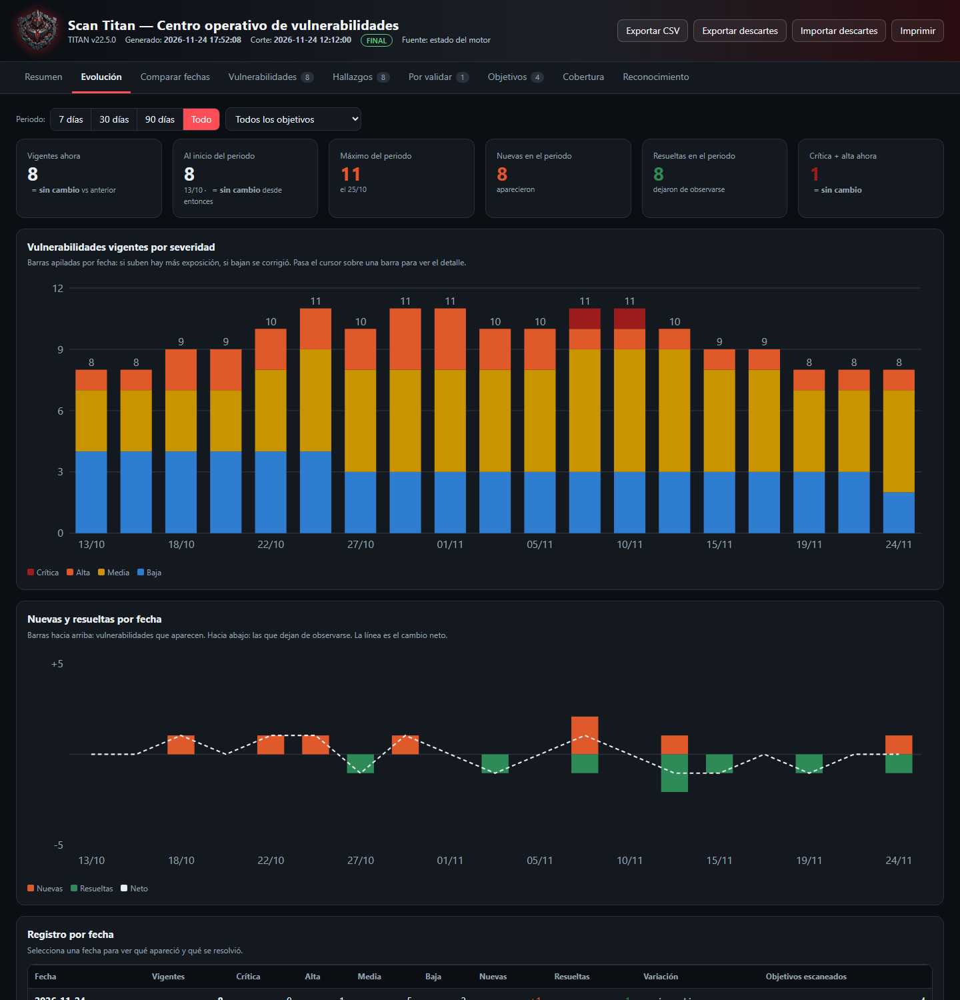
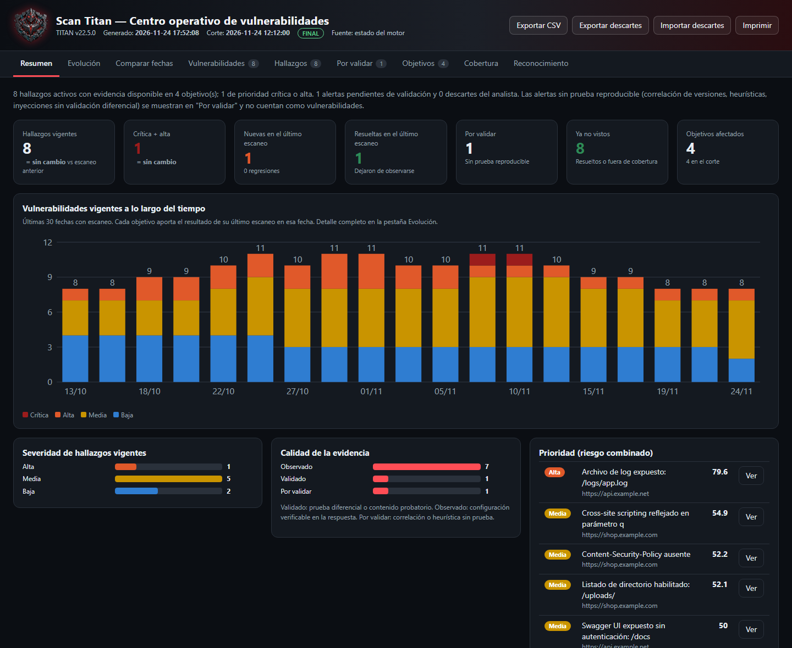
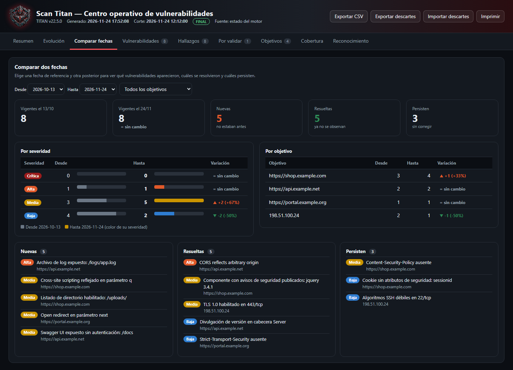
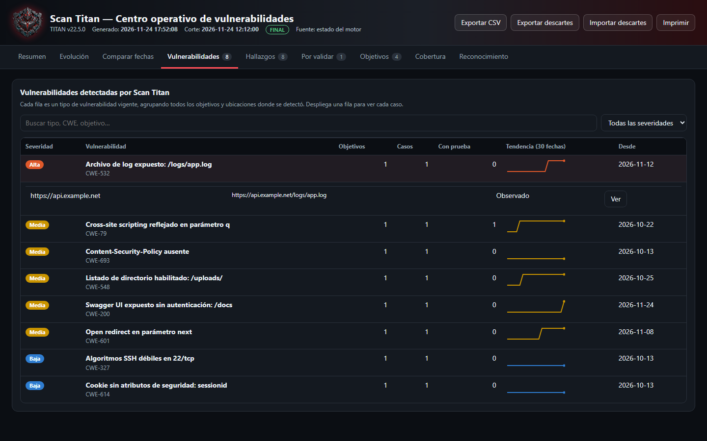
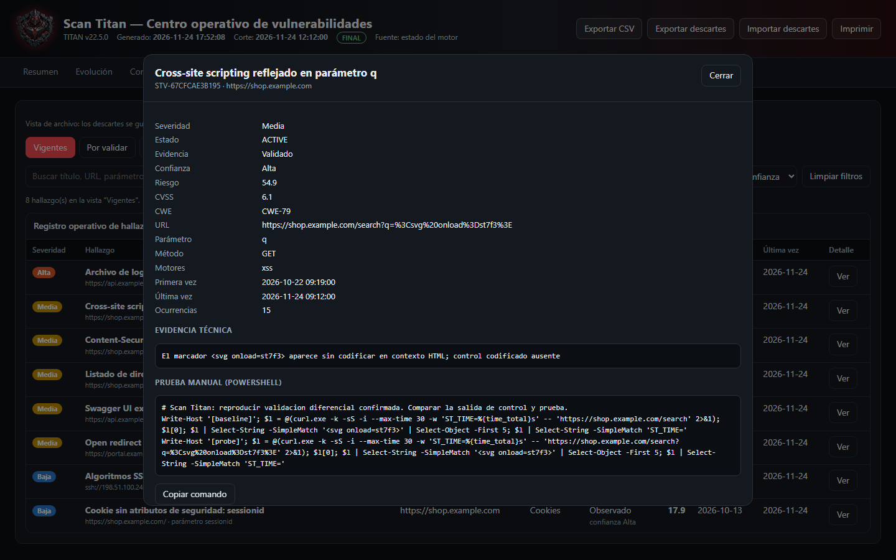
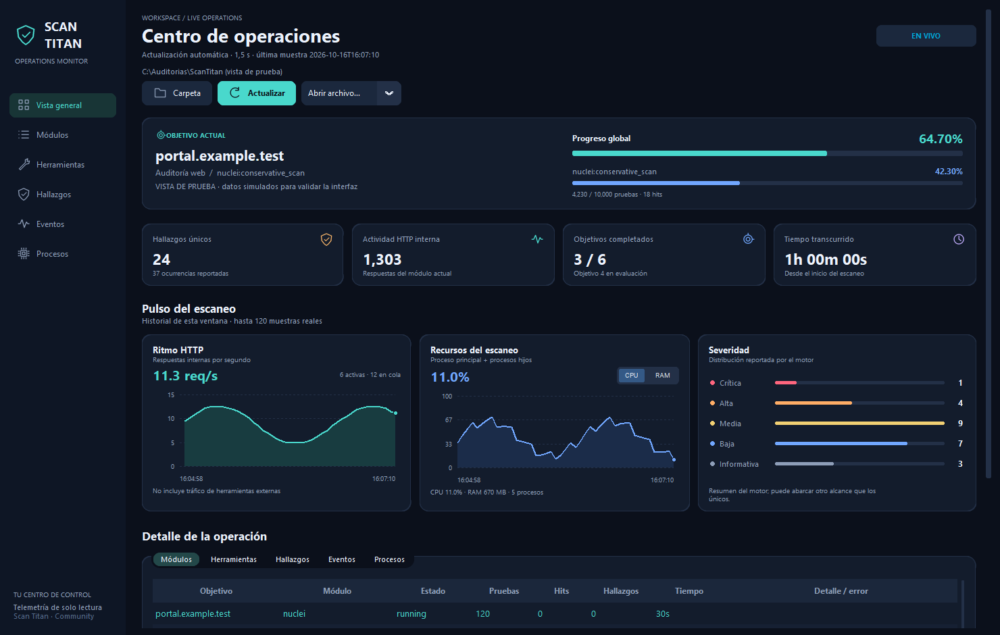

# Scan Titan

 [](LICENSE) [](https://github.com/RogerF5-Security/Scan-Titan/actions/workflows/validacion.yml)

Escáner de vulnerabilidades en Python para Windows y Linux. Reconoce la superficie de un objetivo autorizado y ejecuta pruebas propias junto con Nmap, Nuclei, OWASP ZAP y otras herramientas. Después valida cada hallazgo con controles comparativos y entrega evidencia reproducible. Mantiene además un histórico para comparar cómo evolucionan las vulnerabilidades en el tiempo.

**Versión del motor:** 22.5.0 · [Web: cómo funciona Scan Titan](https://rogerf5-security.github.io/Scan-Titan/) · [Historial de versiones](CHANGELOG.md)



*Todas las capturas usan datos ficticios: dominios reservados `*.example` y el rango de documentación 198.51.100.0/24.*

## Qué hace

| Tarea | Detalle |
| --- | --- |
| **Reconoce** | Puertos, servicios y versiones, tecnologías web, WAF/CDN, subdominios, rutas, APIs y JavaScript. |
| **Prueba** | 28 módulos propios. Cubren inyecciones (SQLi, XSS, LFI, SSTI, comandos), CORS, redirección abierta, SSRF, autenticación y sesión, autorización por roles, TLS, cabeceras, archivos expuestos, servicios FTP/SMB, WebSockets y condiciones de carrera. |
| **Integra** | Nmap NSE, Nuclei, OWASP ZAP, ffuf, WhatWeb, wafw00f, subfinder, Katana y httpx, si están instalados. |
| **Valida** | Compara cada señal con un control. Lo que no se puede demostrar queda en **Por validar**. |
| **Reporta** | Para cada hallazgo entrega evidencia técnica, CWE/OWASP 2025, riesgo combinado y un comando PowerShell que repite la prueba. |
| **Da seguimiento** | Asigna a cada vulnerabilidad una identidad estable. Así sabe cuándo apareció, si persiste, si se corrigió o si volvió. |

## Cómo funciona

```text
targets.txt ─► 1. Preparación ─► 2. Reconocimiento ─► 3. Superficie ─► 4. Pruebas ─► 5. Validación ─► 6. Estado y reportes
```

| Etapa | Qué ocurre |
| --- | --- |
| 1. Preparación | Valida la configuración YAML, las dependencias y las herramientas, y comprueba si el objetivo responde por HTTP. Si no hay web, continúan las pruebas de infraestructura. |
| 2. Reconocimiento | Nmap identifica servicios y versiones, WhatWeb las tecnologías y wafw00f el perímetro. Subfinder, Katana y httpx amplían hosts y rutas. Del JavaScript se extraen endpoints y librerías. Las versiones se cruzan con un [catálogo local de avisos y fin de soporte](docs/VERSION_INTELLIGENCE.md). |
| 3. Superficie | El descubrimiento de rutas empieza por las de mayor valor: `.git`, `.env`, backups, actuator, logs y paneles. Un oráculo soft-404 compara cada respuesta con rutas aleatorias del mismo directorio y extensión. ffuf recibe solo las entradas aún no probadas. |
| 4. Pruebas | Los módulos son asíncronos y cada uno tiene su presupuesto y su timeout. Nuclei usa cinco perfiles: vulnerabilidades, conservador, CVE, servicios de red y DAST. ZAP aporta spider, AJAX spider y escaneo activo. |
| 5. Validación | Cada inyección se repite con una petición de control y otra de prueba, de forma independiente y dos veces. XSS escala a payloads según el contexto de la reflexión. Command injection exige dos resultados aritméticos distintos. |
| 6. Estado y reportes | Los hallazgos se fusionan por identidad canónica, aunque cambie el idioma del título o la URL exacta. Con ese estado se generan el Daily, el informe formal y la matriz Excel. |

Por defecto se procesan dos objetivos a la vez, con un límite global de 20 peticiones HTTP. Las herramientas externas se ejecutan de una en una. Si un módulo o una herramienta agota su tiempo, el motor lo registra y el pipeline continúa.

## Control de falsos positivos

- **Oráculo soft-404:** si una ruta se parece al menos un 90 % a la respuesta de una ruta inexistente, se descarta.
- **Contenido probatorio:** una ruta expuesta solo cuenta si su contenido lo demuestra, por ejemplo la estructura de `.git/config`, líneas de log o la firma de un listado de directorio. Las respuestas 401/403 se registran como reconocimiento.
- **Validación diferencial:** SQLi, XSS y traversal solo se confirman si la diferencia entre control y prueba se reproduce.
- **Por validar:** las correlaciones por versión (Nmap vulners), las heurísticas NSE y las alertas activas sin evidencia en la respuesta siguen visibles, pero no cuentan como vulnerabilidades.
- **Identidad estable:** el mismo fallo descrito en español e inglés, o encontrado en URLs distintas del mismo servicio, queda en un solo registro. Las cookies se identifican por servicio y nombre.

El laboratorio [`tools/vuln_lab.py`](docs/LAB_VALIDATION.md) levanta en `127.0.0.1` una aplicación con vulnerabilidades conocidas, controles negativos y señuelos. Ejecuta el pipeline completo y comprueba que cada comando de verificación reproduce su prueba. Sirve para detectar regresiones entre versiones; un resultado perfecto en el laboratorio no garantiza la misma cobertura en aplicaciones reales. Más criterios en [DAST_PRECISION.md](docs/DAST_PRECISION.md).

## Daily Report

`audit_reports/Daily_vulns_report.html` es un único archivo HTML, sin conexiones externas. Reúne lo que detectó Scan Titan y muestra si la exposición sube, baja o se mantiene.

| Resumen | Comparar fechas |
| --- | --- |
|  |  |
| **Vulnerabilidades** | **Detalle y prueba manual** |
|  |  |

- **Resumen:** vulnerabilidades vigentes, críticas y altas, nuevas y resueltas frente al escaneo anterior, y la tendencia de las últimas 30 fechas.
- **Evolución:** periodos de 7, 30 o 90 días o todo el histórico, con filtro por objetivo. Incluye:
  - Barras por severidad.
  - Nuevas frente a resueltas, con el cambio neto.
  - Una tabla diaria que muestra qué apareció y qué se resolvió en cada fecha.
  - Tendencia por objetivo, mapa de calor, antigüedad y reincidencia.
- **Comparar fechas:** vigentes, nuevas, resueltas y persistentes entre dos fechas, por severidad y por objetivo.
- **Vulnerabilidades:** catálogo agrupado por tipo, con objetivos afectados, casos, casos con prueba, tendencia y primera detección.
- **Hallazgos / Por validar:** registro con filtros, riesgo combinado, detalle con evidencia y comando listo para copiar, y descartes del analista.

**Cómo se calcula el histórico:**

- En cada fecha, cada objetivo aporta su último escaneo hasta ese día. Un objetivo que no se escaneó no cuenta como «resuelto».
- Si un objetivo no responde por HTTP, se conserva su último estado observado.
- Las reglas de calidad se aplican también a los reportes antiguos.

Ejecuta `Abrir_Daily.cmd` o `python main.py --daily-live` para guardar los descartes del analista y que el motor los aplique en los siguientes escaneos.

## Comandos de verificación

Cada hallazgo incluye un comando que repite control y prueba. El comando imprime la línea de estado, el texto que demuestra el fallo y el tiempo de respuesta, sin guardar archivos intermedios.

```powershell
# Scan Titan: reproducir validacion diferencial confirmada. Comparar la salida de control y prueba.
Write-Host '[baseline]'; $l = @(curl.exe -k -sS -i --max-time 30 -w 'ST_TIME=%{time_total}s' -- 'https://shop.example.com/search' 2>&1); $l[0]; $l | Select-String -SimpleMatch '<svg onload=st7f3>' | Select-Object -First 5
Write-Host '[probe]'; $l = @(curl.exe -k -sS -i --max-time 30 -w 'ST_TIME=%{time_total}s' -- 'https://shop.example.com/search?q=%3Csvg%20onload%3Dst7f3%3E' 2>&1); $l[0]; $l | Select-String -SimpleMatch '<svg onload=st7f3>' | Select-Object -First 5
```

Los comandos se adaptan a cada tipo de hallazgo:

- **Rutas, logs y listados:** añaden una petición de control a una ruta inexistente.
- **Nmap:** relanza el script NSE exacto en su puerto.
- **Nuclei:** usa `host:puerto` en las plantillas de red.

## Inicio rápido

Requiere Python 3.11 o posterior.

Windows, PowerShell:

```powershell
git clone https://github.com/RogerF5-Security/Scan-Titan.git
cd Scan-Titan
python -m venv .venv
.\.venv\Scripts\Activate.ps1
powershell -ExecutionPolicy Bypass -File .\install\install.ps1
```

Linux:

```bash
git clone https://github.com/RogerF5-Security/Scan-Titan.git
cd Scan-Titan
python3 -m venv .venv
source .venv/bin/activate
bash install/install.sh
```

Agrega un objetivo por línea en `targets/targets.txt`, revisa `config/config.yaml` y ejecuta:

```text
python main.py --health-check
python main.py
```

Una vez definidos los objetivos, el escaneo se ejecuta sin confirmaciones interactivas. El instalador puede pedir permisos del sistema; revisa sus avisos sobre herramientas faltantes.

| Comando | Función |
| --- | --- |
| `python main.py` | Ejecución zero-touch sobre `targets/targets.txt` |
| `python main.py -t https://app.example.com` | Un único objetivo |
| `python main.py --full` | Máxima cobertura: perfil profundo, navegador, evidencias PNG y wordlists completas |
| `python main.py --profile safe` | Perfil de política (`safe`, `balanced`, `precision`, `daily`, `deep`, `zero-touch`) |
| `python main.py --skip-external` | Solo módulos propios, sin motores externos |
| `python main.py --monitor` | Monitor independiente de solo lectura |
| `python main.py --dashboard` | Regenerar el Daily desde los reportes existentes |
| `python main.py --health-check` | Comprobar estructura, dependencias y herramientas |
| `python main.py --verbose-startup` | Mostrar detalles de arranque y conteos reales de wordlists |
| `python main.py --help` | Todas las opciones |

En Windows, durante el escaneo:

- `P` pausa y `R` reanuda.
- `F` finaliza y genera los reportes con lo encontrado.
- `Ctrl+C` interrumpe.

Nuclei no tiene límite total por defecto: se detiene si pasa 300 segundos sin progreso y conserva la evidencia parcial. Para fijar un límite total, usa `--nuclei-timeout`.

## Monitor en tiempo real



Muestra el progreso global y por módulo, los hallazgos, la actividad HTTP y el consumo de CPU/RAM de Scan Titan y sus procesos hijos. Vista con datos simulados. [Uso y alcance de las métricas](docs/README.md#monitor).

## Reportes

Por defecto se escriben en `audit_reports/`:

| Archivo | Contenido |
| --- | --- |
| `Daily_vulns_report.html` | Histórico, comparación de fechas, catálogo y hallazgos |
| `Formal_Audit_Report_Latest.html` | Informe formal con portada, alcance y detalle |
| `Recon_Matrix.xlsx` | Inventario de reconocimiento y lista raw de rutas `200`/`403` por objetivo |
| `External_Tools_Observability.html` | Estado, duración y evidencia de cada herramienta externa |
| `external reports/` | Salidas crudas de ZAP, wafw00f, Nuclei y Nmap (`reporting.external_reports_dir`) |

Los reportes, sesiones y evidencias permanecen locales y están excluidos de Git. Una instalación puede sobrescribir la configuración en `config/config.local.yaml`, que Git ignora. El archivo versionado `targets/targets.txt` solo debe contener ejemplos comentados.

## Extensión para navegador

Hay una extensión complementaria para el reconocimiento web desde el navegador:

- [Chrome Web Store](https://chromewebstore.google.com/detail/scan-titan/epdbmbbfkmmhkfcfhlpncfkehgcaldcb)
- [Firefox Add-ons](https://addons.mozilla.org/en-US/firefox/addon/scan-titan/)

## Límites y uso autorizado

- Ninguna prueba automatizada garantiza encontrar todas las vulnerabilidades. La lógica de negocio y la autorización entre usuarios requieren configurar identidades y casos ([config/stateful.example.yaml](config/stateful.example.yaml)), además de una revisión manual.
- Ante WAF empresariales con reputación y rate limiting no hay bypass automático.
- Una vulnerabilidad validada demuestra el comportamiento, no el impacto completo en el negocio.
- Ejecuta el motor solo contra activos incluidos en un alcance escrito y ajusta la concurrencia y los perfiles al plan de auditoría.

## Documentación

- [Manual completo](docs/README.md)
- [Arquitectura y configuración](docs/CORE_UPGRADE.md), [cobertura de 55 actividades](docs/METODOLOGIA_55.md) e [inventario de emisores de hallazgos](docs/FINDING_CATALOG.csv)
- [Precisión DAST](docs/DAST_PRECISION.md) y [laboratorio de validación](docs/LAB_VALIDATION.md)
- [Servicios y autenticación](docs/SERVICE_ACCESS.md) y [reconocimiento externo](docs/EXTERNAL_RECON.md)
- [Web pública](https://rogerf5-security.github.io/Scan-Titan/) y [mantenimiento de GitHub Pages](docs/WEB_PUBLICA.md)
- [Guía de publicación](docs/PUBLICACION.md)
- [Licencia MIT](LICENSE)

## Desarrollo

```text
python -B -m unittest discover -s tests -v
python -B tools/vuln_lab.py
python -B tools/leak_gate.py src tests tools docs config README.md CHANGELOG.md
```

Las comprobaciones de GitHub validan el paquete y sus pruebas en Windows y Linux. No ejecutan escaneos contra objetivos externos ni acreditan una instalación completa de todos los motores. `tools/leak_gate.py` bloquea hosts de objetivos, claves, tokens, rutas de usuario y correos antes de publicar.
