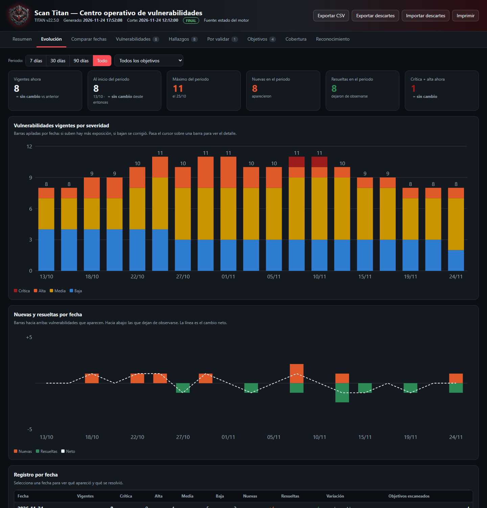

# Scan Titan 22.6.0 — Precisión de detección, Daily histórico y web informativa

Agrupa los cambios registrados en `CHANGELOG.md` desde 22.5.0: control de falsos
positivos, cobertura medida con laboratorio, identidad estable de hallazgos,
Daily histórico y comparativo, y la nueva web informativa.



*Capturas generadas con datos ficticios (`*.example`, 198.51.100.0/24).*

## Daily Report histórico

- **Evolución:** vulnerabilidades vigentes por severidad en cada fecha, nuevas
  frente a resueltas con cambio neto, registro por fecha (qué apareció y qué se
  resolvió), tendencia por objetivo, mapa de calor objetivo × fecha, antigüedad
  y reincidencia. Periodos de 7, 30 o 90 días o todo el histórico, con filtro por
  objetivo.
- **Comparar fechas:** vigentes, nuevas, resueltas y persistentes entre dos
  fechas cualesquiera, por severidad y por objetivo.
- **Vulnerabilidades:** catálogo agrupado por tipo con objetivos afectados,
  casos, casos con prueba, tendencia y primera detección.
- **Hallazgos / Por validar:** tabla ordenable y filtrable, detalle con evidencia
  y comando listo para copiar, descartes del analista, tema claro/oscuro y vista
  móvil. Logo embebido; el archivo sigue siendo un único HTML sin conexiones
  externas.
- **Histórico fiable:** cada fecha usa el último escaneo de cada objetivo (un
  objetivo no escaneado no cuenta como resuelto); un objetivo sin respuesta HTTP
  conserva su último estado observado; las reglas de calidad se aplican también
  a reportes antiguos.

## Control de falsos positivos

- Oráculo soft-404 por origen, directorio y extensión (similitud ≥ 90 % con una
  ruta inexistente → descartada).
- Rutas, logs y listados de directorio exigen contenido probatorio; 401/403
  quedan como reconocimiento.
- Correlaciones por versión (Nmap vulners), heurísticas NSE y alertas activas de
  ZAP sin evidencia pasan a **Por validar** y no cuentan como vulnerabilidades.
- Avisos de componentes: un hallazgo por producto y versión, limitado a Medium.
- Ciclo de vida: un hallazgo ausente pasa a "ya no visto" cuando todas sus
  fuentes terminaron completas.

## Detección

- Descubrimiento de rutas priorizado: ~90 rutas de alto valor (`.git`, `.env`,
  backups, actuator, logs, swagger…) antes de la wordlist completa.
- Módulo nuevo `open_redirect` con control del mismo sitio, host externo único y
  repetición 2/2.
- CORS también sobre endpoints de API descubiertos (incluido JavaScript).
- XSS: escalado a payloads según el contexto de la reflexión.
- Listados de directorio genéricos (Apache, Nginx, IIS, Python, Tomcat).

## Identidad y comandos de verificación

- Identidad canónica estable entre títulos en español/inglés, URLs del mismo
  servicio y cookies (por servicio y nombre); migración del estado que fusiona
  duplicados y guarda `rule_id` y `legacy_ids`.
- OWASP 2025: el CWE del hallazgo prevalece sobre etiquetas persistidas.
- Comandos que imprimen la prueba: estado, líneas con el marcador y tiempo; Nmap
  relanza el script NSE exacto en su puerto; Nuclei usa `host:puerto` en
  plantillas de red; rutas y logs incluyen un control de ruta inexistente.
- El Daily conserva la prueba literal en inyecciones confirmadas.

## Herramientas de calidad

- `tools/vuln_lab.py`: laboratorio de verdad base en `127.0.0.1` con
  vulnerabilidades conocidas, controles negativos y señuelos; mide detección,
  falsos positivos y ejecución de cada comando de verificación
  ([LAB_VALIDATION.md](../LAB_VALIDATION.md)). No sustituye pruebas sobre
  aplicaciones reales.
- `tools/leak_gate.py`: bloquea hosts de objetivos, claves, tokens, rutas de
  usuario y correos antes de publicar.

## Documentación y web

- Web pública reescrita como guía informativa del funcionamiento:
  https://rogerf5-security.github.io/Scan-Titan/
- README reorganizado con pipeline, criterios de precisión, Daily y comandos.

## Actualización

```text
git pull
python main.py --health-check
python main.py --dashboard
```

El estado local se migra automáticamente al cargarlo el motor (identidad
canónica y `rule_id`); `--dashboard` regenera el Daily con el histórico nuevo a
partir de los reportes existentes.
